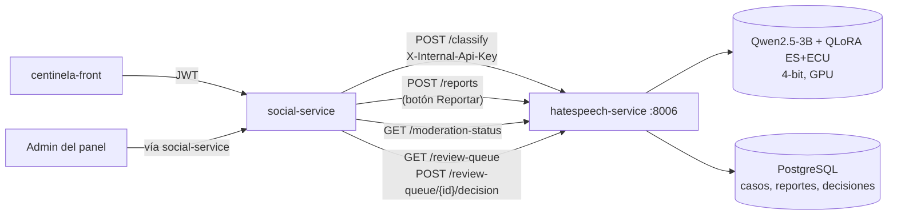
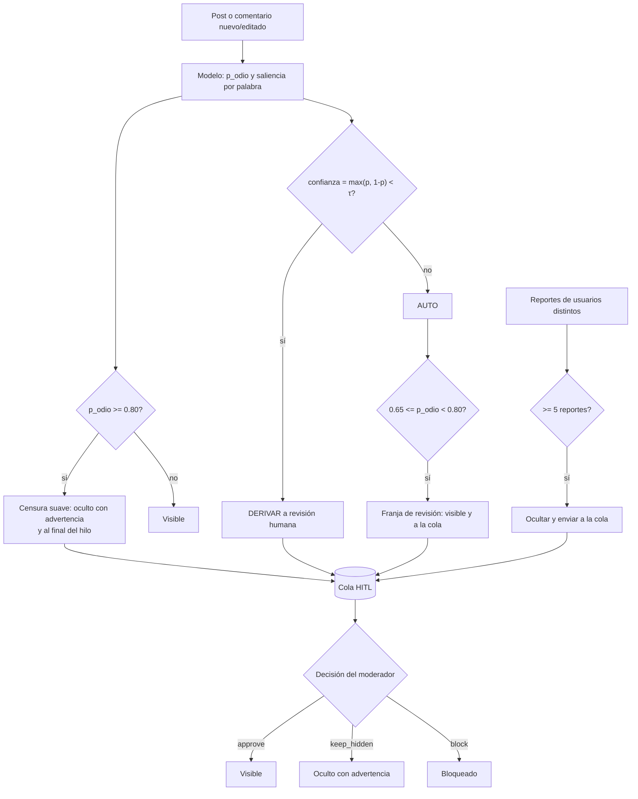

# Centinela — hatespeech-service

Servicio FastAPI de **moderación ética asistida por IA** para Centinela V3. Clasifica posts y
comentarios como discurso de odio/abuso con el modelo de la TIC (**Qwen2.5-3B + adapter QLoRA
ES+ECU**), aplica **censura suave**, gestiona **reportes de usuarios** y mantiene una **cola de
revisión humana (Human-in-the-Loop)** con **explicaciones por palabra (XAI)** y bitácora de
decisiones.

Parte del ecosistema multi-repo de Centinela. **El front nunca llama a este servicio**: el front
habla solo con `social-service`, y es `social-service` quien clasifica, reporta y consulta el
estado de moderación (servicio a servicio).

## Stack

- FastAPI + Uvicorn (ASGI), pydantic-settings
- SQLAlchemy 2 — PostgreSQL 16 en Docker, SQLite en tests
- PyJWT (tokens HS256 de `identity-service`)
- Inferencia: PyTorch (CUDA), transformers, peft, bitsandbytes (4-bit NF4), accelerate
- Backend `mock` sin GPU para desarrollo y CI

## Arquitectura



### Flujo de moderación



Reglas de estado:

- Un caso puede estar en la cola por uno o varios motivos: `hidden_by_model` (`p_odio >= 0.80`),
  `deferred` (confianza < τ), `review_band` (`0.65 <= p_odio < 0.80` sin derivación por τ) y
  `reported`.
- Un contenido derivado por τ o en la franja de revisión **sigue visible** mientras espera
  revisión. Así ningún texto que el modelo etiqueta como odio queda sin ocultar ni revisar.
- La decisión humana prevalece: reclasificar el mismo texto no la cambia. Si el autor **edita**
  el texto, el caso se reevalúa desde cero. Un caso bloqueado no cambia por reclasificación ni
  por reportes; solo otra decisión de moderador lo modifica.
- Los reportes son idempotentes por usuario y no se permite reportar contenido propio. Tras una
  decisión humana, solo cuentan los reportes posteriores para reabrir el caso.
- Cada decisión guarda el estado previo, el moderador, las notas y la `p_odio` del momento.

## Modelo e inferencia

La inferencia reutiliza la lógica de los scripts de evaluación de la TIC:

- `AutoModelForSequenceClassification` (2 clases) sobre `Qwen/Qwen2.5-3B-Instruct`,
  cuantizado a 4-bit NF4 con doble cuantización y cómputo bf16, más el adapter PEFT ES+ECU
  (config 3). Texto crudo, `max_length=128`, tokenizer del adapter.
- `p_odio = softmax(logits)[1]`; etiqueta `odio` si `p_odio >= 0.5`;
  `confianza = max(p_odio, 1 - p_odio)`.
- XAI: saliencia por gradiente (norma L2 del gradiente de `logit_odio - logit_no_odio` respecto
  a los embeddings), agregada por palabra con `offset_mapping`. Si el gradiente falla, se usa
  oclusión (Δ `p_odio` al reemplazar cada token por padding). Se devuelven las `top_k` palabras.

Código: `app/adapters/outbound/classifiers/qwen.py` (modelo) y `app/domain/xai.py` (agregación por
palabra, probada sin GPU).

### Montar el modelo

El modelo **no** va en la imagen ni en el repositorio. En el host:

```
${MODELS_HOST_DIR}/
  qlora_qwen25_3b_es_ecu/      # adapter PEFT + tokenizer (salida del entrenamiento config 3)
${BASE_MODEL_HOST_DIR}/
  Qwen2.5-3B-Instruct/         # config, tokenizer y model-0000x-of-00002.safetensors
```

`docker-compose.yml` monta `MODELS_HOST_DIR` en `/models` y `BASE_MODEL_HOST_DIR` en
`/base-model`, ambos en solo lectura, y `BASE_MODEL=/base-model/Qwen2.5-3B-Instruct`. La imagen
trae `HF_HUB_OFFLINE=1`: no descarga nada en el arranque.

**Windows (Docker Desktop):** no montar directamente `snapshots/` de la caché de Hugging Face.
Ahí los archivos son symlinks de Windows hacia `blobs/` y dentro del contenedor Linux los
pesos aparecen como enlaces rotos. Copiar el snapshot con los archivos reales a
`BASE_MODEL_HOST_DIR`, por ejemplo en PowerShell:

```powershell
$src = "$env:USERPROFILE\.cache\huggingface\hub\models--Qwen--Qwen2.5-3B-Instruct\snapshots\<hash>"
$dst = ".\models\base\Qwen2.5-3B-Instruct"
New-Item -ItemType Directory -Force $dst | Out-Null
Get-ChildItem $src | ForEach-Object {
  $t = @((Get-Item $_.FullName).Target)[0]
  $real = if ($t) { [IO.Path]::GetFullPath((Join-Path $src $t)) } else { $_.FullName }
  Copy-Item -LiteralPath $real -Destination (Join-Path $dst $_.Name)
}
```

En Linux basta con apuntar `BASE_MODEL_HOST_DIR` al snapshot (Docker sigue los symlinks
relativos) o usar `BASE_MODEL=Qwen/Qwen2.5-3B-Instruct` con la caché montada en
`HF_CACHE_HOST_DIR`.

Requisitos: GPU NVIDIA con soporte bf16 (Ampere o superior), driver en el host y
[NVIDIA Container Toolkit](https://docs.nvidia.com/datacenter/cloud-native/container-toolkit/)
(en Windows lo aporta Docker Desktop con WSL2). El compose reserva la GPU con
`deploy.resources.reservations.devices`. Sin GPU, el backend `qwen` no arranca y `/health`
responde 503; para desarrollar use `MODEL_BACKEND=mock`.

Medido en una RTX 3070 Laptop (8 GB) con Docker Desktop/WSL2:

| | Valor |
|---|---|
| VRAM con el modelo cargado | ~2.3 GB |
| VRAM pico con XAI por gradiente (texto de 128 tokens) | ~2.7 GB |
| Latencia `/classify` sin explicación (mediana) | ~0.10 s |
| Latencia `/classify` con explicación (mediana, textos cortos) | ~0.33 s |
| Arranque (carga de pesos desde una carpeta de Windows montada) | ~5 min |

El arranque lento se debe a leer ~6 GB a través del montaje de Windows en WSL2; en un host
Linux o con los pesos en un volumen de Docker es bastante más rápido.

> El backend `mock` es un clasificador léxico determinista que **no** es el modelo de la TIC;
> solo imita su contrato para probar la política, la persistencia y la API.

## Umbrales (congelados)

| Variable | Valor | Origen |
|---|---|---|
| `CLASS_THRESHOLD` | 0.50 | Umbral de clase usado en toda la TIC (`p_odio >= 0.5` → odio). |
| `HITL_TAU` | **0.65** | τ del adapter ES+ECU (config 3), fijado **solo en la validación** EcuHate-es (n = 723) con la regla de la TIC: máxima accuracy automática con ≤ 30 % derivado y n_auto ≥ 50. En test ECU (abierto una sola vez): acc 0.764, F1 macro 0.759, ~26.6 % a HITL. |
| `HITL_TAU` (alternativa) | 0.80 | τ del especialista ES, por si el tráfico es mayoritariamente español general. Deriva más casos. |
| `HIDE_THRESHOLD` | 0.80 | Decisión de producto (no sale de la tesis): solo se oculta lo que el modelo marca con alta probabilidad. |
| `REVIEW_BAND_MIN` | 0.65 | Decisión de producto: desde aquí y hasta `HIDE_THRESHOLD`, lo que el modelo no derivó por τ entra visible a la cola (`review_band`). Coincide con el τ ECU. `REVIEW_BAND_ENABLED=false` la desactiva. |
| `REPORT_THRESHOLD` | 5 | Decisión de producto: reportes de usuarios distintos para ocultar y enviar a revisión. |

Los umbrales no deben ajustarse mirando datos de test. Cada respuesta de `/classify` incluye
los umbrales usados y la versión del modelo, y cada caso los guarda para auditoría.

## Estructura del proyecto

Arquitectura hexagonal ligera, la misma de `predictive-service`: el dominio y los casos de
uso no importan FastAPI, Pydantic ni SQLAlchemy; los adaptadores implementan los puertos y
`bootstrap.py` los conecta. `tests/test_architecture.py` hace cumplir esa regla.

```
app/
  domain/                      # Núcleo puro (sin frameworks)
    entities.py                # Caso, reporte y decisión (dataclasses)
    policy.py                  # Reglas de umbrales
    xai.py                     # Saliencia por palabra
    errors.py                  # Errores de dominio
  application/
    ports.py                   # Puertos: clasificador, repositorio y configuración
    moderation_service.py      # Casos de uso: clasificar, reportar, cola HITL, decidir
  adapters/outbound/
    classifiers/               # mock (dev/CI) y qwen (QLoRA en GPU)
    persistence/               # Engine, tablas + mapeo imperativo y repositorio SQLAlchemy
  api/                         # Adaptador de entrada HTTP
    deps.py                    # Sesión por petición, servicio y clasificador
    serializers.py             # Entidades → esquemas públicos
    v1/endpoints/
      classify.py              # POST /classify
      reports.py               # POST /reports
      review_queue.py          # Cola HITL, detalle y decisiones
      moderation_status.py     # Estado de un contenido
  core/
    config.py                  # Configuración por variables de entorno
    security.py                # API key interna, JWT y verificación de moderador
  models/
    schemas.py                 # Esquemas Pydantic (contrato HTTP)
  bootstrap.py                 # Raíz de composición: elige e inyecta los adaptadores
  main.py                      # App, lifespan (BD + modelo) y /health
tests/
```

## Requisitos previos

- Docker y Docker Compose; para el modelo real, GPU NVIDIA + NVIDIA Container Toolkit.
- Sin Docker: Python 3.11+.

## Levantar en local

### Con Docker

```bash
cp .env.example .env        # completar claves y rutas del modelo
docker network create centinela-net   # si aún no existe
docker compose up -d --build
```

La API queda en `http://127.0.0.1:8008` (solo localhost). Dentro de `centinela-net` el
servicio sigue siendo `http://hatespeech-service:8006`: es la URL que `social-service`
tiene en `HATESPEECH_SERVICE_URL`. El puerto 8006 del host lo publica `analytics-service`
desde octubre de 2026; por eso el mapeo del host es 8008 y se cambia con
`HATESPEECH_PUBLISH_PORT`. Para una imagen sin CUDA: `docker build --build-arg INSTALL_GPU=false .`
y `MODEL_BACKEND=mock`.

### Sin Docker (modo mock)

```bash
python -m venv venv
source venv/bin/activate    # Windows: venv\Scripts\activate
pip install -r requirements-dev.txt
MODEL_BACKEND=mock uvicorn app.main:app --host 0.0.0.0 --port 8006 --reload
```

## Variables de entorno

Ver `.env.example`. Principales:

| Variable | Descripción |
|---|---|
| `MODEL_BACKEND` | `qwen` (modelo real, GPU) o `mock` (desarrollo/CI). |
| `BASE_MODEL` | Modelo base: ruta local montada (`/base-model/Qwen2.5-3B-Instruct`) o id de Hugging Face presente en la caché. |
| `ADAPTER_PATH` | Ruta del adapter dentro del contenedor (`/models/qlora_qwen25_3b_es_ecu`). |
| `MODEL_VERSION` | Etiqueta de versión que se guarda en cada caso. |
| `MAX_LENGTH` | Longitud máxima de tokens (128, igual que en entrenamiento). |
| `EXPLANATION_ENABLED` / `EXPLANATION_TOP_K` | Activa XAI y número de palabras devueltas. |
| `CLASS_THRESHOLD`, `HIDE_THRESHOLD`, `HITL_TAU`, `REVIEW_BAND_ENABLED`, `REVIEW_BAND_MIN`, `REPORT_THRESHOLD` | Umbrales (ver tabla). |
| `DATABASE_URL` | URL SQLAlchemy (`postgresql+psycopg2://...` en Docker). |
| `JWT_SIGNING_KEY` / `JWT_ALGORITHM` | Misma clave HS256 que `identity-service` y `social-service`. |
| `INTERNAL_API_KEY` | Clave compartida con `social-service` (header `X-Internal-Api-Key`). |
| `MODELS_HOST_DIR` / `BASE_MODEL_HOST_DIR` / `HF_CACHE_HOST_DIR` | Carpetas del host montadas para el adapter, el modelo base y la caché HF. |
| `HATESPEECH_PUBLISH_PORT` | Puerto en el host (default `8008`). No cambia el puerto interno `8006`. |
| `HF_HUB_OFFLINE` / `TRANSFORMERS_OFFLINE` | `1` por defecto en la imagen: no se descarga nada en el arranque. |

## Autenticación

- **Servicio a servicio (principal):** `X-Internal-Api-Key`. `social-service` propaga quién
  actúa en `X-Acting-User-Id`. En la cola HITL ese id es el usuario de la clave compartida
  de admin (`ADMIN_CENTINELA`), después de validar `X-Admin-Token`.
- **JWT de `identity-service`:** `Authorization: Bearer <access>`; el usuario sale de
  `user_id`, `company_id` o `sub`. Alcanza para reportar y leer el estado. No abre la cola.

| Endpoint | API key interna | JWT de usuario |
|---|---|---|
| `POST /classify` | ✔ | ✘ |
| `POST /reports` | ✔ (`reporter_id` o `X-Acting-User-Id`) | ✔ (denunciante = token) |
| `GET /moderation-status/...` | ✔ | ✔ |
| `GET /review-queue`, detalle, decisión | ✔ con `X-Acting-User-Id` del admin | ✘ |

## API (`/api/v1`)

- **`POST /classify`** — `{text, content_type: post|comment, content_id, author_id?, explain?}`.
  Devuelve `label`, `p_hate`, `confidence`, `decision` (`AUTO`/`DERIVAR`), `action` recomendada,
  `visibility` efectiva, `review_status`, `reasons`, `explanation.top_tokens`, `model` y
  `thresholds`. `decision` refleja solo la regla de τ de la tesis; si el caso entra a la cola
  lo indican `review_status` y `reasons` (un caso `AUTO` en la franja llega con `review_band`).
- **`POST /reports`** — `{content_type, content_id, reporter_id?, reason?, text?, author_id?}`.
  201 si es un reporte nuevo, 200 si el usuario ya había reportado. Devuelve `report_count`,
  `threshold_reached`, `visibility`, `review_status` y `reasons`. `social-service` copia
  `reasons` al post o comentario; si la clave no viniera, la visibilidad se actualizaría
  y los motivos locales quedarían viejos.
- **`GET /review-queue`** — filtros `status` (`pending`|`resolved`|`all`), `reason`
  (`hidden_by_model`|`reported`|`deferred`|`review_band`), `content_type`, `limit`, `offset`.
- **`GET /review-queue/{id}`** — caso con texto, explicación, motivos de reporte y bitácora.
- **`POST /review-queue/{id}/decision`** — `{decision: approve|keep_hidden|block, notes?}`.
- **`GET /moderation-status/{content_type}/{content_id}`** — `visibility`, `show_warning`,
  `sort_last`, `review_status`, `reasons`, `report_count`. Un contenido nunca clasificado
  devuelve `classified: false` y visible.
- **`GET /health`** — estado del modelo y de la base; 503 si alguno falla.

Ejemplo (modo mock):

```bash
curl -s -X POST http://127.0.0.1:8008/api/v1/classify \
  -H 'Content-Type: application/json' -H "X-Internal-Api-Key: $INTERNAL_API_KEY" \
  -d '{"text":"Esa gente es escoria","content_type":"comment","content_id":42}'
```

## Documentación (Swagger)

Schema OpenAPI en `GET /api/v1/openapi.json` y UI en `/docs`. `custom_openapi()` recorta el
prefijo `/api/v1` y declara `servers: [{"url": "/api/hatespeech"}]`, igual que el resto de
servicios FastAPI detrás del gateway. `/` y `/health` quedan fuera del schema.

## Tests

```bash
pytest
```

Corre con el backend `mock` y SQLite en memoria (ver `conftest.py`); no necesita GPU ni
Postgres. La cobertura mínima es **90 %** (`--cov-fail-under=90` en `pyproject.toml`).
`app/adapters/outbound/classifiers/qwen.py` se excluye de la cobertura porque requiere CUDA; su lógica
de explicación vive en `xai.py`, que sí está probada. Lint: `ruff check` y `black --check`
(línea de 100), con las versiones de `requirements-dev.txt`.

## CI/CD

El pipeline sigue el de los servicios FastAPI de Centinela (`governance-service`,
`analytics-service`, `ethical-recommender-service`): control de calidad en
`ubuntu-latest`, cobertura ≥ 90 % y build de imagen, más un CD a staging al
empujar `develop` y a producción al empujar `main`.

| Workflow | Cuándo | Qué hace |
|---|---|---|
| `ci.yml` | push a `develop`, PR a `develop`/`main` | Nombre de rama, `ruff`, `black`, `pytest` en modo mock, `docker compose config`, imagen sin CUDA y smoke test de `/health`. |
| `cd-production.yml` | push a `main` | El mismo control de calidad y, si el deploy está habilitado, despliegue a producción. |
| `add-to-project.yml` | issue abierto | Agrega el issue al Project de la organización si existe `ORG_PROJECT_TOKEN`. |

Los jobs de deploy (`runs-on: [self-hosted, staging]` y `[self-hosted, production]`)
están escritos como los de la organización: `git reset --hard` en
`/opt/centinela/hatespeech-service`, `docker compose up -d --build` y rollback si
`/health` no responde. **No se ejecutan** mientras la variable de repositorio
`CENTINELA_DEPLOY_ENABLED` no sea `true`, así un repo sin los runners de la
organización no deja el workflow en cola ni en rojo.

Para activarlos hace falta:

- Un runner self-hosted con etiqueta `staging` (push a `develop`) y otro con
  etiqueta `production` (push a `main`). Los runners de
  `PlataformaIntegradaInvestigadores` no están registrados en este repo.
- El checkout del servidor en `/opt/centinela/hatespeech-service`, con `.env`
  (a partir de `.env_produccion.example`) y los volúmenes del modelo. Esos
  valores no son secrets de GitHub: viven en el host, igual que en los otros
  servicios.
- La variable de repositorio `CENTINELA_DEPLOY_ENABLED=true`.
- `ORG_PROJECT_TOKEN` (PAT con acceso al Project de la organización) solo para
  `add-to-project.yml`. Si falta, ese workflow termina en verde y no agrega el issue.

Diferencias respecto del workflow de la org, a propósito:

- El build de CI usa `INSTALL_GPU=false` y prueba `/health` en modo mock. No
  descarga PyTorch CUDA ni los pesos.
- La validación del nombre de rama está copiada en este repo (el workflow
  reusable de la org no acepta el prefijo `cursor/` de los cloud agents, y
  este repo no pertenece a la organización). Acepta `feature/*`, `chore/*` y
  `cursor/*` hacia `develop`, y `hotfix/*` hacia `main`.
- El healthcheck del deploy pega a `127.0.0.1:8008`, no a `8006`.

## Pendientes conocidos

- Sin migraciones: las tablas se crean al arrancar (`create_all`). Agregar Alembic antes de
  cambiar el esquema en producción.
- Inferencia en serie (un lock por modelo); suficiente para el volumen inicial.
- La integración con `social-service` y `centinela-front` está en las ramas
  `feature/hatespeech-moderation` de esos repos (sin merge). Este servicio ya
  expone el contrato que esas ramas llaman: `POST /api/v1/classify`,
  `POST /api/v1/reports`, la cola `/api/v1/review-queue` y `/health`.

## Convenciones

- Ramas: `main` (estable), `develop` (integración), `feature/*` mergeadas a `develop`.
- Commits: [Conventional Commits](https://www.conventionalcommits.org/) en inglés, con el
  porqué en el cuerpo.
- Estilo: `ruff` (líneas de 100 columnas).
