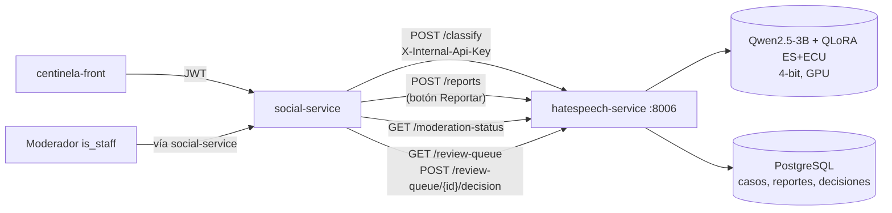
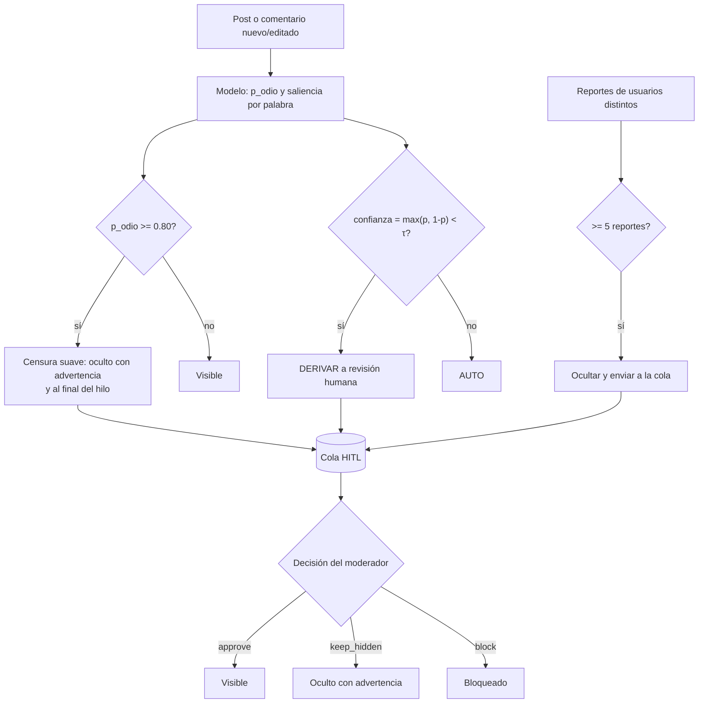

# Centinela — hatespeech-service

Servicio FastAPI de **moderación ética asistida por IA** para Centinela V3. Clasifica posts y
comentarios como discurso de odio/abuso con el modelo de la TIC (**Qwen2.5-3B + adapter QLoRA
ES+ECU**), aplica **censura suave**, gestiona **reportes de usuarios** y mantiene una **cola de
revisión humana (Human-in-the-Loop)** con **explicaciones por palabra (XAI)** y bitácora de
decisiones.

Parte del ecosistema multi-repo de Centinela. **El front nunca llama a este servicio**: el front
habla solo con `social-service`, y es `social-service` quien clasifica, reporta y consulta el
estado de moderación (servicio a servicio).

## Stack

- FastAPI + Uvicorn (ASGI), pydantic-settings
- SQLAlchemy 2 — PostgreSQL 16 en Docker, SQLite en tests
- PyJWT (tokens HS256 de `identity-service`)
- Inferencia: PyTorch (CUDA), transformers, peft, bitsandbytes (4-bit NF4), accelerate
- Backend `mock` sin GPU para desarrollo y CI

## Arquitectura



### Flujo de moderación



Reglas de estado:

- Un caso puede estar en la cola por uno o varios motivos: `hidden_by_model`, `deferred`
  (τ) y `reported`.
- Un contenido derivado por τ pero con `p_odio < 0.80` **sigue visible** mientras espera revisión.
- La decisión humana prevalece: reclasificar el mismo texto no la cambia. Si el autor **edita**
  el texto, el caso se reevalúa desde cero. `block` es definitivo.
- Los reportes son idempotentes por usuario y no se permite reportar contenido propio. Tras una
  decisión humana, solo cuentan los reportes posteriores para reabrir el caso.
- Cada decisión guarda el estado previo, el moderador, las notas y la `p_odio` del momento.

## Modelo e inferencia

La inferencia reutiliza la lógica de los scripts de evaluación de la TIC:

- `AutoModelForSequenceClassification` (2 clases) sobre `Qwen/Qwen2.5-3B-Instruct`,
  cuantizado a 4-bit NF4 con doble cuantización y cómputo bf16, más el adapter PEFT ES+ECU
  (config 3). Texto crudo, `max_length=128`, tokenizer del adapter.
- `p_odio = softmax(logits)[1]`; etiqueta `odio` si `p_odio >= 0.5`;
  `confianza = max(p_odio, 1 - p_odio)`.
- XAI: saliencia por gradiente (norma L2 del gradiente de `logit_odio - logit_no_odio` respecto
  a los embeddings), agregada por palabra con `offset_mapping`. Si el gradiente falla, se usa
  oclusión (Δ `p_odio` al reemplazar cada token por padding). Se devuelven las `top_k` palabras.

Código: `app/services/classifiers/qwen.py` (modelo) y `app/services/xai.py` (agregación por
palabra, probada sin GPU).

### Montar el modelo

El modelo **no** va en la imagen ni en el repositorio. En el host:

```
${MODELS_HOST_DIR}/
  qlora_qwen25_3b_es_ecu/      # adapter PEFT + tokenizer (salida del entrenamiento config 3)
${HF_CACHE_HOST_DIR}/          # caché de Hugging Face con Qwen/Qwen2.5-3B-Instruct
```

`docker-compose.yml` monta `MODELS_HOST_DIR` en `/models` (solo lectura) y la caché en
`/home/appuser/.cache/huggingface`. `BASE_MODEL` puede ser un id de Hugging Face (se descarga
la primera vez en la caché) o una ruta local montada.

Requisitos: GPU NVIDIA con soporte bf16 (Ampere o superior; estimado 4–6 GB de VRAM para el
modelo en 4-bit más la XAI por gradiente), driver en el host y
[NVIDIA Container Toolkit](https://docs.nvidia.com/datacenter/cloud-native/container-toolkit/).
El compose reserva la GPU con `deploy.resources.reservations.devices`. Sin GPU, el backend
`qwen` no arranca y `/health` responde 503; para desarrollar use `MODEL_BACKEND=mock`.

> El backend `mock` es un clasificador léxico determinista que **no** es el modelo de la TIC;
> solo imita su contrato para probar la política, la persistencia y la API.

## Umbrales (congelados)

| Variable | Valor | Origen |
|---|---|---|
| `CLASS_THRESHOLD` | 0.50 | Umbral de clase usado en toda la TIC (`p_odio >= 0.5` → odio). |
| `HITL_TAU` | **0.65** | τ del adapter ES+ECU (config 3), fijado **solo en la validación** EcuHate-es (n = 723) con la regla de la TIC: máxima accuracy automática con ≤ 30 % derivado y n_auto ≥ 50. En test ECU (abierto una sola vez): acc 0.764, F1 macro 0.759, ~26.6 % a HITL. |
| `HITL_TAU` (alternativa) | 0.80 | τ del especialista ES, por si el tráfico es mayoritariamente español general. Deriva más casos. |
| `HIDE_THRESHOLD` | 0.80 | Decisión de producto (no sale de la tesis): solo se oculta lo que el modelo marca con alta probabilidad. |
| `REPORT_THRESHOLD` | 5 | Decisión de producto: reportes de usuarios distintos para ocultar y enviar a revisión. |

Los umbrales no deben ajustarse mirando datos de test. Cada respuesta de `/classify` incluye
los umbrales usados y la versión del modelo, y cada caso los guarda para auditoría.

## Estructura del proyecto

```
app/
  api/
    deps.py                    # Inyección de sesión, servicio y clasificador
    serializers.py             # ORM → esquemas públicos
    v1/endpoints/
      classify.py              # POST /classify
      reports.py               # POST /reports
      review_queue.py          # Cola HITL, detalle y decisiones
      moderation_status.py     # Estado de un contenido
  core/
    config.py                  # Configuración por variables de entorno
    database.py                # Engine y sesiones SQLAlchemy
    security.py                # API key interna, JWT y verificación de moderador
  models/
    db.py                      # Tablas: casos, reportes, decisiones
    schemas.py                 # Esquemas Pydantic
  services/
    classifiers/               # base, mock, qwen (QLoRA) y factory
    moderation_service.py      # Casos de uso
    policy.py                  # Reglas de umbrales (pura)
    xai.py                     # Saliencia por palabra
  main.py                      # App, lifespan (BD + modelo) y /health
tests/
```

## Requisitos previos

- Docker y Docker Compose; para el modelo real, GPU NVIDIA + NVIDIA Container Toolkit.
- Sin Docker: Python 3.11+.

## Levantar en local

### Con Docker

```bash
cp .env.example .env        # completar claves y rutas del modelo
docker network create centinela-net   # si aún no existe
docker compose up -d --build
```

La API queda en `http://localhost:8006` (publicada solo en `127.0.0.1`). Para una imagen sin
CUDA: `docker build --build-arg INSTALL_GPU=false .` y `MODEL_BACKEND=mock`.

### Sin Docker (modo mock)

```bash
python -m venv venv
source venv/bin/activate    # Windows: venv\Scripts\activate
pip install -r requirements.txt
MODEL_BACKEND=mock uvicorn app.main:app --host 0.0.0.0 --port 8006 --reload
```

## Variables de entorno

Ver `.env.example`. Principales:

| Variable | Descripción |
|---|---|
| `MODEL_BACKEND` | `qwen` (modelo real, GPU) o `mock` (desarrollo/CI). |
| `BASE_MODEL` | Modelo base (`Qwen/Qwen2.5-3B-Instruct` o ruta local). |
| `ADAPTER_PATH` | Ruta del adapter dentro del contenedor (`/models/qlora_qwen25_3b_es_ecu`). |
| `MODEL_VERSION` | Etiqueta de versión que se guarda en cada caso. |
| `MAX_LENGTH` | Longitud máxima de tokens (128, igual que en entrenamiento). |
| `EXPLANATION_ENABLED` / `EXPLANATION_TOP_K` | Activa XAI y número de palabras devueltas. |
| `CLASS_THRESHOLD`, `HIDE_THRESHOLD`, `HITL_TAU`, `REPORT_THRESHOLD` | Umbrales (ver tabla). |
| `DATABASE_URL` | URL SQLAlchemy (`postgresql+psycopg2://...` en Docker). |
| `JWT_SIGNING_KEY` / `JWT_ALGORITHM` | Misma clave HS256 que `identity-service` y `social-service`. |
| `INTERNAL_API_KEY` | Clave compartida con `social-service` (header `X-Internal-Api-Key`). |
| `STAFF_CHECK_MODE` / `STAFF_USER_IDS` | Cómo se reconoce a un moderador en llamadas con JWT. `STAFF_USER_IDS` es una lista JSON, p. ej. `["12","15"]`. |
| `MODELS_HOST_DIR` / `HF_CACHE_HOST_DIR` | Carpetas del host montadas para el modelo y la caché. |

## Autenticación

- **Servicio a servicio (principal):** `X-Internal-Api-Key`. `social-service` propaga al usuario
  con `X-Acting-User-Id` y, para moderadores, `X-Acting-User-Is-Staff: true` (lo obtiene de su
  `IdentityPrincipal.is_staff`).
- **JWT de `identity-service`:** `Authorization: Bearer <access>`; el usuario sale de
  `user_id`, `company_id` o `sub`.
- **Brecha conocida:** hoy el JWT de `identity-service` **no incluye `is_staff`**. Por eso la
  verificación de moderador en llamadas con JWT es configurable (`claim`, `allowlist` o ambas).
  El rol de moderador definitivo queda pendiente con el equipo de gobernanza; por ahora
  `is_staff` actúa como moderador.

| Endpoint | API key interna | JWT usuario | JWT moderador |
|---|---|---|---|
| `POST /classify` | ✔ | ✘ | ✔ |
| `POST /reports` | ✔ (`reporter_id` o `X-Acting-User-Id`) | ✔ (denunciante = token) | ✔ |
| `GET /moderation-status/...` | ✔ | ✔ | ✔ |
| `GET /review-queue`, detalle, decisión | ✔ con moderador identificado | ✘ | ✔ |

## API (`/api/v1`)

- **`POST /classify`** — `{text, content_type: post|comment, content_id, author_id?, explain?}`.
  Devuelve `label`, `p_hate`, `confidence`, `decision` (`AUTO`/`DERIVAR`), `action` recomendada,
  `visibility` efectiva, `review_status`, `reasons`, `explanation.top_tokens`, `model` y
  `thresholds`.
- **`POST /reports`** — `{content_type, content_id, reporter_id?, reason?, text?, author_id?}`.
  201 si es un reporte nuevo, 200 si el usuario ya había reportado. Devuelve `report_count` y
  `threshold_reached`.
- **`GET /review-queue`** — filtros `status` (`pending`|`resolved`|`all`), `reason`
  (`hidden_by_model`|`reported`|`deferred`), `content_type`, `limit`, `offset`.
- **`GET /review-queue/{id}`** — caso con texto, explicación, motivos de reporte y bitácora.
- **`POST /review-queue/{id}/decision`** — `{decision: approve|keep_hidden|block, notes?}`.
- **`GET /moderation-status/{content_type}/{content_id}`** — `visibility`, `show_warning`,
  `sort_last`, `review_status`, `reasons`, `report_count`. Un contenido nunca clasificado
  devuelve `classified: false` y visible.
- **`GET /health`** — estado del modelo y de la base; 503 si alguno falla.

Ejemplo (modo mock):

```bash
curl -s -X POST http://localhost:8006/api/v1/classify \
  -H 'Content-Type: application/json' -H "X-Internal-Api-Key: $INTERNAL_API_KEY" \
  -d '{"text":"Esa gente es escoria","content_type":"comment","content_id":42}'
```

## Documentación (Swagger)

Schema OpenAPI en `GET /api/v1/openapi.json` y UI en `/docs`. `custom_openapi()` recorta el
prefijo `/api/v1` y declara `servers: [{"url": "/api/hatespeech"}]`, igual que el resto de
servicios FastAPI detrás del gateway. `/` y `/health` quedan fuera del schema.

## Tests

```bash
pytest
```

Corre con el backend `mock` y SQLite en memoria (ver `conftest.py`); no necesita GPU ni
Postgres. La cobertura mínima es **90 %** (`--cov-fail-under=90` en `pyproject.toml`).
`app/services/classifiers/qwen.py` se excluye de la cobertura porque requiere CUDA; su lógica
de explicación vive en `xai.py`, que sí está probada.

## CI/CD

`.github/workflows/ci.yml` corre en push y PR hacia `develop` y `main`:

1. `ruff check` y `ruff format --check`.
2. Tests con cobertura ≥ 90 %.
3. Build de la imagen sin CUDA (`INSTALL_GPU=false`) y smoke test de `/health` en modo mock.

Aún no hay despliegue automático: el modelo real necesita un host con GPU.

## Pendientes conocidos

- Sin migraciones: las tablas se crean al arrancar (`create_all`). Agregar Alembic antes de
  cambiar el esquema en producción.
- Inferencia en serie (un lock por modelo); suficiente para el volumen inicial.
- Integración con `social-service` (llamadas al crear/editar, botón Reportar, vista de la cola).

## Convenciones

- Ramas: `main` (estable), `develop` (integración), `feature/*` mergeadas a `develop`.
- Commits: [Conventional Commits](https://www.conventionalcommits.org/) en inglés, con el
  porqué en el cuerpo.
- Estilo: `ruff` (líneas de 100 columnas).
